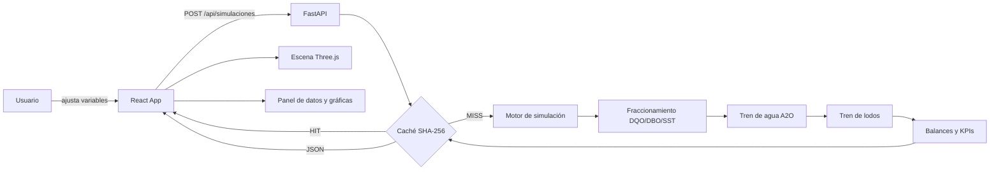
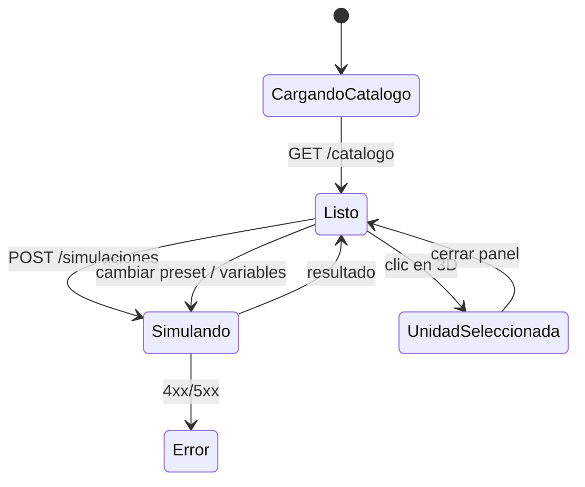

# Fase 2 · Arquitectura React + FastAPI

## 1. Objetivos de la arquitectura

1. Separar el **motor de simulación** (Python/NumPy/SciPy) de la **interfaz**
   (React/Three.js) mediante un contrato HTTP estable.
2. Permitir que la escena 3D sea **dirigida por datos**: la geometría, los
   colores y las etiquetas se construyen a partir del catálogo y del resultado
   de la simulación, no de valores codificados en el frontend.
3. Mantener el cálculo pesado en el servidor y la animación a 60 fps en el
   cliente.
4. Ser reproducible: mismas entradas ⇒ mismas salidas, con caché por hash.

## 2. Vista general



## 3. Stack

| Capa | Tecnología | Versión | Rol |
|---|---|---|---|
| UI | React | 18.3 | Componentes y estado |
| Build | Vite | 5.4 | Dev server y bundle |
| 3D | Three.js | 0.169 | Escena, materiales, raycasting |
| Controles | OrbitControls | addons | Órbita, zoom, paneo |
| Etiquetas | CSS2DRenderer | addons | Etiquetas HTML ancladas a objetos |
| API | FastAPI | 0.115 | Validación y endpoints |
| Validación | Pydantic | 2.10 | Esquemas de entrada |
| Cálculo | NumPy / SciPy | 2.2 / 1.15 | Álgebra y solve_ivp |
| Servidor | Uvicorn | 0.34 | ASGI |
| Pruebas | Pytest + HTTPX | 8.3 / 0.28 | Unitarias y de API |

No se usan librerías de gráficas ni de UI: los indicadores y las gráficas se
dibujan con SVG y CSS para reducir dependencias y mantener el control visual.

## 4. Estructura del repositorio

```
Corte_3/
├── backend/
│   ├── app/
│   │   ├── main.py                 # FastAPI, CORS, estáticos
│   │   ├── schemas.py              # Pydantic (entrada)
│   │   ├── api/
│   │   │   └── routes.py           # /api/*, caché LRU
│   │   └── simulation/
│   │       ├── constants.py        # cinética y estequiometría
│   │       ├── streams.py          # corriente y propiedades
│   │       ├── quality.py          # DBO5 / DQO / SST y fraccionamiento
│   │       ├── units.py            # pretratamiento, primario, desinfección
│   │       ├── biological.py       # ASM1 reducido + A2O
│   │       ├── sludge.py           # espesador, digestor, deshidratación
│   │       └── plant.py            # orquestación y catálogo 3D
│   ├── tests/
│   ├── requirements.txt
│   └── README.md
├── frontend/
│   ├── package.json
│   ├── vite.config.js
│   ├── index.html
│   └── src/
│       ├── main.jsx
│       ├── App.jsx
│       ├── styles.css
│       ├── api/client.js
│       ├── hooks/useSimulation.js
│       ├── three/PlantScene.js
│       ├── components/
│       └── lib/
├── docs/
│   ├── 01_procesos_ptar.md
│   ├── 02_arquitectura.md
│   ├── 03_modelos_dbo_dqo_sst.md
│   └── 04_visualizacion_3d.md
└── README.md
```

## 5. Contrato de la API

### `GET /api/catalogo`

Devuelve la definición de las 13 unidades (posición, forma, dimensiones,
color), las ecuaciones del modelo, los presets y los valores por defecto.

```json
{
  "unidades": [
    {
      "id": "aerobio",
      "nombre": "Zona aerobia",
      "tipo": "biologico",
      "forma": "tanque",
      "posicion": [17.0, 0.0, 0.0],
      "dimensiones": [17.0, 3.2, 8.0],
      "color": "#22d3ee"
    }
  ],
  "ecuaciones": [],
  "presets": [],
  "limites_default": {}
}
```

### `POST /api/simulaciones`

```json
{
  "influente": {
    "caudal_m3_d": 9000,
    "dbo5_mg_l": 240,
    "dqo_mg_l": 455,
    "sst_mg_l": 230,
    "ssv_mg_l": 185,
    "ntk_mg_l": 42,
    "nh4_mg_l": 32,
    "pt_mg_l": 7,
    "temperatura_c": 22
  },
  "diseno": {
    "biologico": {
      "volumen_anaerobio_m3": 900,
      "volumen_anoxico_m3": 1800,
      "volumen_aerobio_m3": 5400,
      "ras": 0.8,
      "recirculacion_interna": 3.0,
      "purga_m3_d": 180,
      "svi_ml_g": 140
    },
    "desinfeccion": { "metodo": "cloro", "dosis_cloro_mg_l": 4 }
  },
  "limites": { "dbo5_mg_l": 50, "dqo_mg_l": 150, "sst_mg_l": 50 }
}
```

Respuesta (resumida):

```json
{
  "afluente": { "dqo_mg_l": 455, "dbo5_mg_l": 240, "sst_mg_l": 230 },
  "etapas": [
    {
      "id": "primario",
      "nombre": "Sedimentador primario",
      "entrada": {},
      "salida": {},
      "remocion": { "dbo5_pct": 39.8, "dqo_pct": 40.0, "sst_pct": 70.7 },
      "info": { "sor_m3_m2_d": 29.2 }
    }
  ],
  "reactores": [],
  "tren_lodos": { "resumen": {} },
  "efluente": {},
  "kpis": {},
  "limites": {},
  "balance": {},
  "perfil": []
}
```

Códigos: `200` éxito, `422` error de validación o simulación inviable,
`404` preset inexistente. Cabeceras `X-Simulation-Cache` y
`X-Model-Version`.

### Otros endpoints

| Método | Ruta | Función |
|---|---|---|
| GET | `/api/salud` | Estado y tamaño de caché |
| GET | `/api/presets` | Lista de escenarios |
| GET | `/api/presets/{id}` | Escenario completo |
| GET | `/api/ecuaciones` | Ecuaciones para la pestaña Modelo |

## 6. Flujo de estado en React



El estado vive en `App.jsx` y se compone de:

- `catalogo`: unidades, ecuaciones, presets, límites.
- `form`: valores del afluente y del diseño.
- `resultado`: salida completa de la simulación.
- `seleccion`: id de la unidad inspeccionada.
- `vista`: pestaña activa (`operacion`, `efluente`, `lodos`, `modelo`).
- `escena`: etiquetas, flujos, rotación automática, calidad del agua.
- `cargando`, `error`.

`useSimulation` encapsula el `fetch`, el aborto de peticiones anteriores y el
manejo de errores. La escena se actualiza mediante un método imperativo
`scene.update(resultado)` para no recrear geometría en cada render de React.

## 7. Arquitectura de la escena 3D

```
SceneView (React)
   │ useEffect
   ▼
PlantScene (clase Three.js)
   ├── Renderer + cámara + OrbitControls
   ├── Luces (hemisférica, direccional con sombras, relleno)
   ├── Terreno + rejilla + cielo
   ├── Unidades (Map id → Group)
   │     ├── geometría según `forma`
   │     ├── superficie de agua animada
   │     ├── burbujas (zona aerobia)
   │     └── etiqueta CSS2D
   ├── Tuberías (CatmullRomCurve3 + partículas de flujo)
   ├── Raycaster (clic y hover)
   └── animate() con requestAnimationFrame
```

La escena **no depende de React Three Fiber** para mantener el bundle pequeño y
el control explícito del ciclo de vida. React sólo monta y desmonta la escena y
le envía datos.

### Materiales y calidad visual

- `MeshStandardMaterial` con `roughness` 0.55–0.85 y `metalness` 0.1.
- Agua con textura de cáusticas generada en canvas y `offset` animado.
- Tuberías con `TubeGeometry` y partículas emisivas que recorren la curva.
- Selección con emisivo y anillo en el suelo; hover con cambio de cursor.
- Etiquetas HTML con `CSS2DRenderer` para texto nítido a cualquier zoom.
- Sombras PCF suaves y `ACESFilmicToneMapping`.

### Actualización con la simulación

| Elemento 3D | Fuente de datos |
|---|---|
| Color del agua | DQO de salida de la etapa (`qualityColor`) |
| Etiqueta | DBO5, DQO o SST de salida |
| Burbujas | Intensidad de aireación (`aire_m3_d`) |
| Anillo del digestor | Producción de biogás |
| Panel lateral | `etapas`, `reactores`, `tren_lodos`, `kpis` |
| Alertas | `limites` y `balance` |

## 8. Despliegue

### Desarrollo

```bash
# Terminal 1
cd backend
.venv\Scripts\python.exe -m uvicorn app.main:app --reload --port 8000

# Terminal 2
cd frontend
npm install
npm run dev
```

Vite proxyfica `/api` a `http://127.0.0.1:8000` (ver `vite.config.js`), por lo
que no hay CORS en desarrollo.

### Producción

```bash
cd frontend
npm run build          # genera frontend/dist

cd ../backend
.venv\Scripts\python.exe -m uvicorn app.main:app --host 0.0.0.0 --port 8000
```

FastAPI sirve `frontend/dist` en `/app` y la API en `/api`. Un solo proceso y
un solo puerto; alternativa: Nginx para estáticos y Uvicorn como upstream.

## 9. Pruebas y calidad

- **Unitarias:** fraccionamiento DQO/DBO/SST, conservación de masa, eficiencias.
- **Integración:** simulación municipal completa, cierre de balance, tiempos.
- **API:** validación 422, presets, caché HIT/MISS, catálogo.
- **Frontend:** la escena se prueba manualmente con los cuatro presets; el
  build de Vite falla ante errores de sintaxis o imports.

El integrador LSODA de SciPy no es reentrante. Como FastAPI atiende los
endpoints síncronos en un threadpool, `biological.py` serializa la integración
con un `threading.Lock`; el resto del cálculo sigue en paralelo. La caché LRU
de 24 escenarios evita repetir trabajo y mantiene la respuesta instantánea.

## 10. Decisiones y compromisos

| Decisión | Motivo |
|---|---|
| Three.js puro en vez de R3F | Menor bundle, control del ciclo de vida, requisito académico |
| Modelo ASM1 reducido | Equilibrio entre rigor y tiempo de cálculo (8–30 s) |
| Estado cuasi-estacionario de solubles | Elimina rigidez y acelera 100× |
| Caché por hash | Respuesta instantánea al repetir escenarios |
| Catálogo 3D en el backend | Una sola fuente de verdad para datos y geometría |
| Fósforo simplificado | Evita balances irreales; se documenta la limitación |
